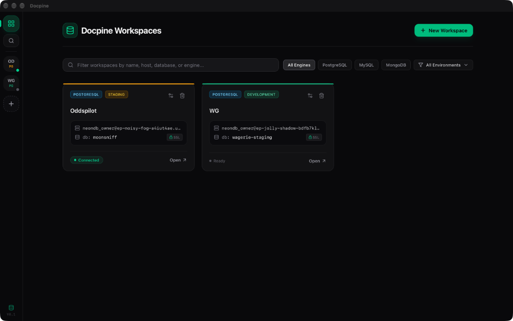
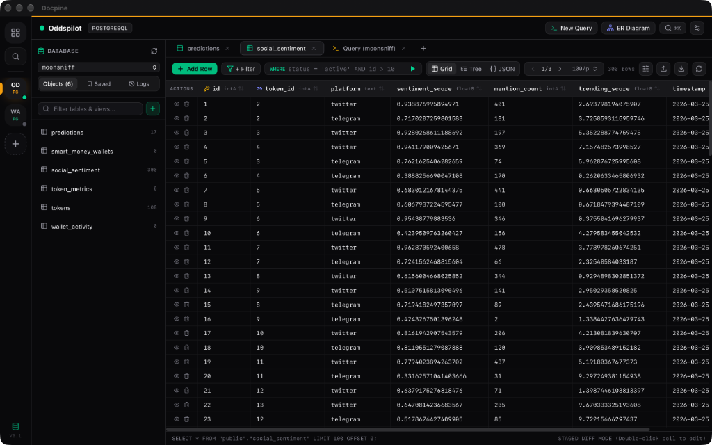

# Docpine 🌲

> **Next-Generation Desktop Database Management Tool for SQL & NoSQL**  
> *One Connection = One Isolated Workspace.* Built with **Tauri v2 (Rust)**, **React 19**, **TypeScript**, **Tailwind CSS v4**, and **Bun**.

---

<p align="center">
  
</p>

---

## ⚡ Overview

**Docpine** is a high-performance native desktop application designed for modern software teams, database administrators, and developers working across both relational SQL and document-based NoSQL databases.

Unlike traditional database managers where opening multiple databases turns into a messy tree of overlapping windows and disconnected query tabs, Docpine introduces the **Isolated Workspace Model**:
* **1 Database Connection = 1 Dedicated Workspace**
* Each workspace preserves its own active tabs, data grid filters, pagination, scroll state, staged drafts, and query history.
* Switch between staging, production, and local environments in milliseconds without reloading or losing your in-flight edits.

---

## 📸 Interface Preview

### Workspaces Launchpad
The command center for all your databases. Organize databases by engine, environment tag (Production, Staging, Development, Local), and connection status with custom color accents and SSL/SSH indicators.


### Workspace Data Grid & Schema Explorer
Deep inspection, in-place cell editing, advanced visual filtering, and multi-tab exploration.



---

## ✨ Key Features

- **Multi-Engine SQL & NoSQL Support**:
  - 🐘 **PostgreSQL**: Native driver connection, schema-aware introspection, live tuple count statistics, and DDL inspection.
  - 🐬 **MySQL & MariaDB**: Full relational query runner, auto-increment handling, backtick-escaped DDL generation, and index tracking.
  - 🍃 **MongoDB**: Document collection management, MQL runner (`find`, `aggregate`, `insertOne`, `updateMany`, etc.), and BSON ObjectId support.
- **Triple-View Data Exploration**:
  - **Grid View**: Virtualized data table with smooth scrolling, double-click inline editing, and draft cell commits.
  - **Tree View**: Interactive nested document explorer for complex hierarchical data and BSON payloads.
  - **JSON Editor**: Raw JSON document view for bulk structural payload modifications.
- **Safe Staged Mutations**:
  - Staged Diff Mode: Review pending inserts, edits, and deletions with count chips and discard options before applying atomically with <kbd>⌘</kbd> + <kbd>S</kbd>.
  - Immediate Mode: Option for instant auto-committing when rapid testing is preferred.
  - Safe Guardrails: Built-in Read-Only modes and protection against accidental unfiltered `DELETE` or `DROP` statements.
- **Monaco SQL & MQL Editor**:
  - Embedded Monaco code editor with database syntax highlighting.
  - Saved workspace queries and searchable execution logs with latency metrics.
- **Interactive ER Diagram (Entity-Relationship Graph)**:
  - Visual schema relationship graphs powered by `@xyflow/react` and Dagre auto-layout.
  - Interactive nodes with direct one-click navigation to the table's data explorer.
- **Structure Designer**:
  - Inspect and alter column definitions, primary keys, foreign keys, and indexes directly from a clean UI.
- **Secure by Design**:
  - Custom TLS/SSL CA certificates.
  - Native SSH Bastion Tunneling (password & Ed25519/RSA private key support).
  - Passwords and SSH secrets stored encrypted in the OS Keychain via native Rust integration.
- **Import & Export**:
  - Fast client-side import and export supporting CSV, JSON, and SQL insert statements.

---

## 🛠️ Architecture & Tech Stack

| Layer | Technology |
|---|---|
| **Desktop Runtime** | [Tauri v2](https://v2.tauri.app/) (Rust 2021) |
| **Frontend Framework** | [React 19](https://react.dev/) + [TypeScript](https://www.typescriptlang.org/) |
| **Styling** | [Tailwind CSS v4](https://tailwindcss.com/) (Minimal CSS footprint) |
| **Runtime & Package Manager** | [Bun](https://bun.sh/) |
| **Query Editor** | [Monaco Editor](https://microsoft.github.io/monaco-editor/) |
| **Diagramming** | [@xyflow/react](https://reactflow.dev/) + Dagre |
| **State Management** | [Zustand](https://github.com/pmndrs/zustand) |

---

## 🚀 Getting Started

### Prerequisites

Ensure you have the following installed:
1. **[Bun](https://bun.sh/)** (v1.1+ recommended)
2. **[Rust & Cargo](https://rustup.rs/)** (v1.75+)
3. System prerequisites for Tauri v2 on your OS (Xcode Command Line Tools on macOS; build-essential, webkit2gtk on Linux).

### Installation

1. **Clone the repository**:
   ```bash
   git clone https://github.com/ifeanyidotdev/docpine.git
   cd docpine
   ```

2. **Install dependencies**:
   ```bash
   bun install
   ```

3. **Run in development mode**:
   ```bash
   bun run tauri dev
   ```

4. **Build native production release**:
   ```bash
   bun run tauri build
   ```

---

## ⌨️ Keyboard Shortcuts

| Shortcut | Action |
|---|---|
| <kbd>⌘</kbd> + <kbd>K</kbd> / <kbd>Ctrl</kbd> + <kbd>K</kbd> | Open Command Palette (jump to workspace, table, collection, query, or ERD) |
| <kbd>⌘</kbd> + <kbd>0</kbd> / <kbd>Ctrl</kbd> + <kbd>0</kbd> | Navigate to Workspaces Launchpad |
| <kbd>⌘</kbd> + <kbd>1</kbd> .. <kbd>9</kbd> | Switch directly to Workspace 1 through 9 |
| <kbd>⌘</kbd> + <kbd>S</kbd> / <kbd>Ctrl</kbd> + <kbd>S</kbd> | Commit Staged Database Changes |
| <kbd>Esc</kbd> | Dismiss modals, popovers, and cell editor |

---

## 📄 License & Terms of Use

Docpine is licensed under the **Docpine Software License**. See the [LICENSE](LICENSE) file for complete details.

### Summary:
- **Free for Personal, Educational, and Research Use**: You are free to view, study, modify, and run the code for personal, non-commercial purposes.
- **Attribution (Shoutout Required)**: Any use, distribution, or derivative work must include explicit attribution to the original author: **Ifeanyichukwu Sampson Ebenezer** ([ifeanyi.dev](https://ifeanyi.dev)).
- **Commercial & Re-purposing Restriction**: Selling, white-labeling, re-branding, commercial hosting, or re-purposing the software as a paid or proprietary service is **strictly prohibited without prior explicit written permission** from the author.

To request commercial licensing, partnership, or permission for re-purposing, please contact the author at **ifeanyi.dev**.
